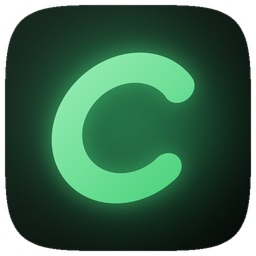
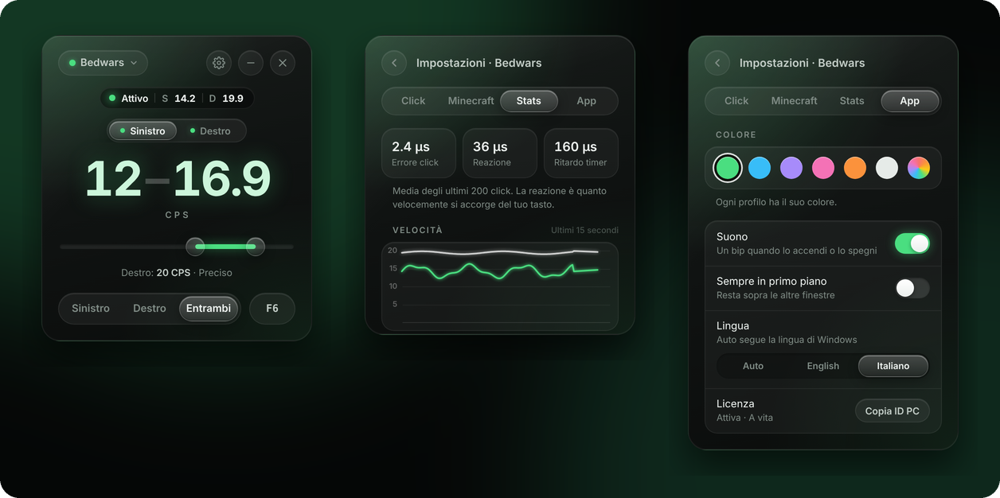
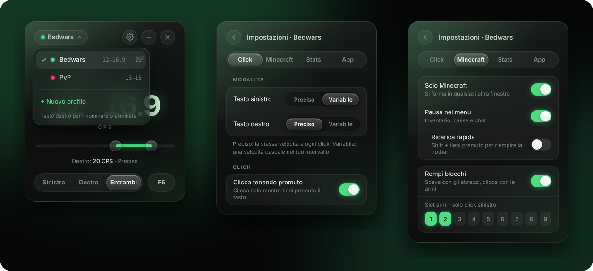

# Cadence

**L'autoclicker preciso e leggero per Minecraft su Windows.**

[🇬🇧 English](README.md) · 🇮🇹 Italiano

 

Sempre l'ultima versione · Windows 10 e 11 · <a href="../../releases/latest">installer e versioni precedenti</a>

  

 

## 💡 Perché Cadence

- 🛡️ **Non tocca mai il gioco.** Nessuna injection, nessuna mod, nessuna lettura della memoria di Minecraft. Per Windows e per il gioco è solo un mouse.
- 🎯 **Misurato, non promesso.** La scheda **Stats** mostra quanto sono precisi i tuoi click sul tuo PC, in microsecondi, con un grafico della velocità dal vivo.
- ⚡ **Nessun ritardo.** Legge il mouse con Raw Input, quindi la tua mira non rallenta mai, anche a 8000 Hz.
- 🧠 **Intelligente in gioco.** Si mette in pausa nei menu, tiene premuto quando scavi e segue i tuoi tasti della hotbar.
- 🪶 **Leggero.** Circa 6 MB, 0% di CPU da spento, e si nasconde nella tray mentre giochi.
- 🌍 **Parla la tua lingua.** Italiano, inglese, spagnolo, francese, tedesco, portoghese, polacco e russo, scelta in automatico da Windows.
- 🔄 **Sempre aggiornato.** Le versioni nuove si installano con un clic, ognuna con l'elenco delle novità.
- 🤝 **Assistenza diretta.** Parli con lo sviluppatore: `zuan01` su Discord.

 

## 🛒 Acquista Cadence

Cadence è a pagamento. Ogni licenza attiva **un PC**.

| Piano | Prezzo | |
| :--- | ---: | :--- |
| **Settimanale** · 7 giorni | **€1,99** | Provalo nelle tue prossime partite |
| **1 mese** · 30 giorni | **€3,99** | ⭐ Il più scelto |
| **3 mesi** · 90 giorni | **€8,99** | Risparmi il 25% |
| **1 anno** · 365 giorni | **€14,99** | Risparmi il 69% |
| **A vita** | **€19,99** | 💎 Il più conveniente · tutti gli aggiornamenti futuri |

**Come acquistare:** scrivi a **`zuan01`** su Discord.

**Pagamento:** 💳 PayPal o 🪙 crypto: **USDC o USDT su Solana** (consigliato: commissioni quasi zero, confermato in pochi secondi) oppure **LTC**. `zuan01` ti manda l'indirizzo.

1. [Scarica Cadence](https://github.com/Riccardo-coder/Cadence/releases/latest/download/Cadence.exe) e aprilo.
2. Premi **Copia** accanto a **IL TUO ID PC** e invialo a `zuan01` su Discord con il piano che vuoi.
3. Dopo il pagamento ricevi la tua chiave di licenza. Incollala in Cadence e premi **Attiva**.

La chiave è creata solo per il tuo PC e resta valida anche se reinstalli Windows.

 

## ✨ Funzioni

<table>
<tr>
<td width="50%" valign="top">

### 🎯 Click
- **Da 1 a 20 CPS con un decimale**, per esempio 16.9, o **fino a 100** alzando il limite di velocità. Trascina lo slider o scrivi il numero.
- **Preciso** (velocità esatta) o **Variabile** (velocità casuale nel tuo intervallo).
- **Sinistro, destro o entrambi** insieme, ognuno con la sua velocità.
- **Clicca tenendo premuto**: clicca solo mentre tieni premuto il tasto.
- **Nessun click accumulato**, velocità costante anche mentre fai block-hit.

</td>
<td width="50%" valign="top">

### ⛏️ Fatto per Minecraft
- **Pausa nei menu**: si ferma in inventario, casse e chat.
- **Rompi blocchi**: clicca con le armi e tiene premuto con gli attrezzi, così puoi scavare. Segue i tuoi tasti della hotbar.
- **Ricarica rapida**: Shift + tieni premuto per riempire la hotbar.
- **Solo Minecraft**: si ferma in qualsiasi altra finestra.
- Funziona dalla 1.7 all'ultima versione, con Lunar, Badlion e Bedrock.

</td>
</tr>
<tr>
<td width="50%" valign="top">

### ⚡ Prestazioni
- Ogni click parte a pochi **microsecondi** dal momento giusto.
- **Raw Input**: nessun ritardo sul mouse, anche a 8000 Hz.
- Reagisce **all'istante** al tuo tasto, ai menu e alle finestre.
- **0% di CPU** da spento. Misure dal vivo e **grafico della velocità** nella scheda **Stats**.

</td>
<td width="50%" valign="top">

### 🎨 Comodità
- Design scuro con **il colore che vuoi**, diverso **per ogni profilo**.
- Capsula di stato con i tuoi **CPS dal vivo**.
- **Profili** e **qualsiasi tasto di attivazione**, compresi i tasti laterali del mouse.
- **Menu nella tray**, nascondi nella tray, sempre in primo piano, ricorda la posizione.
- **Aggiornamenti con un clic** e interfaccia in **8 lingue**: italiano, inglese, spagnolo, francese, tedesco, portoghese, polacco e russo.

</td>
</tr>
</table>

 

## 🚀 Per iniziare

1. Apri Cadence e scegli i tuoi CPS.
2. Premi **F6** (o il tuo tasto). La capsula in alto passa da **Spento** a **Pronto**.
3. In gioco tieni premuto il tasto del mouse: clicca finché lo tieni premuto.
4. Premi di nuovo **F6** per spegnerlo.

| Capsula | Significato |
| :--- | :--- |
| ⚪ **Spento** | Disattivato |
| 🟢 **Pronto** | Acceso, aspetta che tieni premuto il tasto |
| 🟢 **Attivo** | Sta cliccando, con la velocità dal vivo |
| 🟡 **In pausa** | È aperto un menu, oppure Minecraft non è in primo piano |
| ⭕ **Attrezzo in mano** | Rompi blocchi: tiene premuto per farti scavare |

<b>Buono a sapersi</b>

 

- Funziona **in finestra, senza bordi e a schermo intero**.
- **Scrivere in chat**: se il tasto di attivazione è una lettera o un numero, non fa niente mentre è aperto un menu o la chat. I tasti funzione e i tasti laterali del mouse funzionano sempre.
- **Gira una sola copia alla volta**, così i click non si raddoppiano mai.
- **Minecraft avviato come amministratore**: avvia anche Cadence come amministratore, altrimenti Windows blocca i click.
- **Cursori personalizzati nei menu**: una mod che disegna un suo cursore nei menu può impedire la pausa nell'inventario.

 

## 🔒 Privacy e sicurezza

- **Funziona fuori dal gioco.** Cadence non entra in Minecraft e non legge la sua memoria. I click passano dall'input normale di Windows, come un mouse vero.
- **Nessun account, nessun tracciamento.** Non raccoglie dati e non invia niente su di te o sul tuo PC.
- **Internet solo per gli aggiornamenti.** Si collega solo a GitHub, per controllare se c'è una versione nuova e scaricarla quando lo decidi tu. La licenza viene controllata sul tuo PC, senza internet.
- **Cosa legge:** mouse e tastiera (per sapere quando tieni premuto) e il file delle impostazioni di Minecraft, in sola lettura, per conoscere i tasti della hotbar.
- **I tuoi file:** impostazioni e licenza restano in `%APPDATA%\dev.autoclicker.desktop\`.

 

## ❓ Domande frequenti

<b>Rischio il ban?</b>

 

Cadence funziona come un mouse vero e non tocca il gioco, ma molti server multiplayer non permettono gli autoclicker e possono accorgersi dei click automatici. Controlla le regole del server dove giochi: Cadence è pensato per il single player e per i server che lo permettono.

<b>Con quali versioni e client funziona?</b>

 

Java Edition dalla 1.7 all'ultima versione, compresi Lunar, Badlion e altri client, e Bedrock Edition. In finestra, senza bordi e a schermo intero.

<b>E se reinstallo Windows o cambio PC?</b>

 

Reinstallare Windows non è un problema: la chiave continua a funzionare. Una licenza vale per un PC, quindi per un PC nuovo scrivi a `zuan01` su Discord.

<b>Come si aggiorna?</b>

 

Cadence controlla da solo se ci sono versioni nuove. Quando ne esce una, in alto nell'app compare una freccia: premila e Cadence scarica l'aggiornamento e si riavvia. Impostazioni e licenza restano.

<b>Windows dice "PC protetto da Windows". È sicuro?</b>

 

È SmartScreen: avvisa per le app nuove non ancora firmate. Scegli **Ulteriori informazioni → Esegui comunque**. Compare solo la prima volta.

<b>Rallenta il PC o il gioco?</b>

 

No. Da spento usa 0% di CPU e non aggiunge ritardi al mouse. Mentre giochi puoi nasconderlo nella tray per liberare anche memoria.

<b>Quale piano scelgo?</b>

 

Inizia con il **Settimanale** per provarlo nelle tue partite. Se ti piace, il piano **A vita** costa più o meno come cinque mesi e include tutti gli aggiornamenti futuri.

 

Domande o una licenza? Scrivi a <b>zuan01</b> su Discord.

