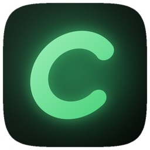
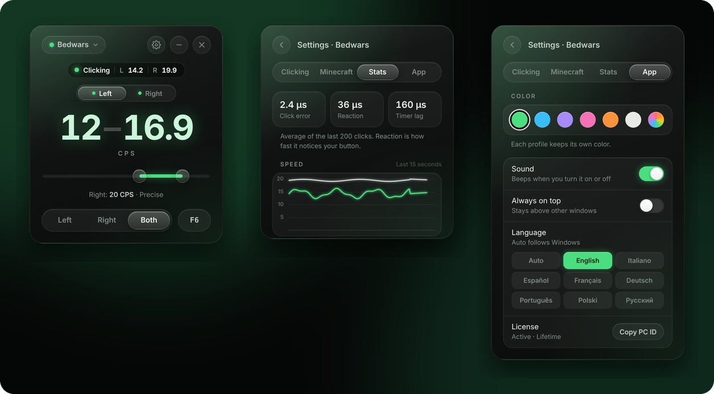
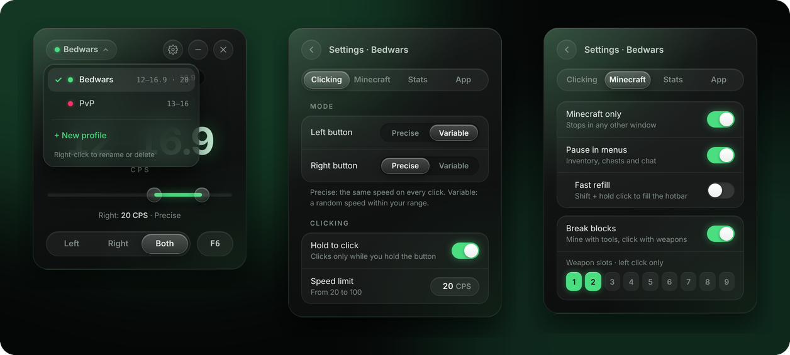

# Cadence

**The precise, lightweight autoclicker for Minecraft on Windows.**

🇬🇧 English · [🇮🇹 Italiano](README.it.md)

 

Always the latest version · Windows 10 and 11 · <a href="../../releases/latest">installer and older versions</a>

  

 

## 💡 Why Cadence

- 🛡️ **Never touches the game.** No injection, no mods, no reading of Minecraft's memory. To Windows and to the game, it is just a mouse.
- 🎯 **Measured, not promised.** The **Stats** tab shows how precise your clicks are on your own PC, in microseconds, with a live speed graph.
- ⚡ **No input lag.** It reads your mouse with Raw Input, so your aim is never slowed down, even at 8000 Hz.
- 🧠 **Smart in game.** It pauses in menus, holds the click when you mine, and follows your own hotbar keys.
- 🪶 **Light.** About 6 MB, 0% CPU when idle, and it hides to the tray while you play.
- 🌍 **Speaks your language.** English, Italian, Spanish, French, German, Portuguese, Polish and Russian, picked automatically from Windows.
- 🔄 **Always up to date.** New versions install with one click, each with its list of changes.
- 🤝 **Direct support.** You talk to the developer: `zuan1` on Discord.

 

## 🛒 Buy Cadence

Cadence is a paid app. Each license unlocks **one PC**.

| Plan | Price | |
| :--- | ---: | :--- |
| **Weekly** · 7 days | **€1.99** | Try it in your next sessions |
| **1 Month** · 30 days | **€3.99** | ⭐ Most popular |
| **3 Months** · 90 days | **€8.99** | Save 25% |
| **1 Year** · 365 days | **€14.99** | Save 69% |
| **Lifetime** | **€19.99** | 💎 Best value · all future updates |

**How to buy:** message **`zuan1`** on Discord.

**Payment:** 💳 PayPal or 🪙 crypto: **USDC or USDT on Solana** (recommended: near-zero fees, confirmed in seconds) or **LTC**. `zuan1` sends you the address.

1. [Download Cadence](https://github.com/Riccardo-coder/Cadence/releases/latest/download/Cadence.exe) and open it.
2. Press **Copy** next to **YOUR PC ID** and send it to `zuan1` on Discord with the plan you want.
3. After payment you receive your license key. Paste it into Cadence and press **Activate**.

Your key is made for your PC only, and it keeps working after you reinstall Windows.

 

## ✨ Features

<table>
<tr>
<td width="50%" valign="top">

### 🎯 Clicking
- **1 to 20 CPS with one decimal**, like 16.9, or **up to 100** if you raise the speed limit. Drag the slider or type the number.
- **Precise** (exact speed) or **Variable** (random speed in your range).
- **Left, Right or Both** at once, each with its own speed.
- **Hold to click**: clicks only while you hold the button.
- **No stacked clicks**, steady speed while block-hitting.

</td>
<td width="50%" valign="top">

### ⛏️ Made for Minecraft
- **Pause in menus**: stops in inventory, chests and chat.
- **Break blocks**: clicks with weapons, holds the click with tools so you can mine. Follows your own hotbar keys.
- **Fast refill**: Shift + hold to fill your hotbar.
- **Minecraft only**: stops in any other window.
- Works on 1.7 to the latest version, Lunar, Badlion and Bedrock.

</td>
</tr>
<tr>
<td width="50%" valign="top">

### ⚡ Performance
- Every click lands within **microseconds** of its time.
- **Raw Input**: adds no delay to your mouse, even at 8000 Hz.
- Reacts **instantly** to your button, menus and windows.
- **0% CPU** while idle. Live measurements and a **speed graph** in the **Stats** tab.

</td>
<td width="50%" valign="top">

### 🎨 Comfort
- Dark design with **any color you like**, a different one **per profile**.
- Status capsule with your **live CPS**.
- **Profiles** and **any toggle key**, mouse side buttons included.
- **Tray menu**, hide to tray, always on top, remembers its place.
- **One-click updates** and an interface in **8 languages**: English, Italian, Spanish, French, German, Portuguese, Polish and Russian.

</td>
</tr>
</table>

 

## 🚀 Quick start

1. Open Cadence and choose your CPS.
2. Press **F6** (or your toggle key). The capsule at the top changes from **Off** to **Ready**.
3. In game, hold the mouse button: it clicks while you hold it.
4. Press **F6** again to turn it off.

| Capsule | Meaning |
| :--- | :--- |
| ⚪ **Off** | Turned off |
| 🟢 **Ready** | On, waiting for you to hold the button |
| 🟢 **Clicking** | Clicking, with the live speed |
| 🟡 **Paused** | A menu is open, or Minecraft is not in front |
| ⭕ **Tool in hand** | Break blocks: holding the click so you can mine |

<b>Good to know</b>

 

- **Windowed, borderless and fullscreen** all work.
- **Typing in chat**: a letter or digit used as toggle key does nothing while a menu or the chat is open. Function keys and mouse side buttons always work.
- **Only one copy runs at a time**, so clicks are never doubled.
- **Minecraft running as administrator**: run Cadence as administrator too, or Windows blocks its clicks.
- **Custom menu cursors**: a mod that draws its own cursor in menus can stop the inventory pause from working.

 

## 🔒 Privacy and safety

- **Runs outside the game.** Cadence never injects into Minecraft and never reads its memory. Clicks go through the normal Windows input, like a real mouse.
- **No account, no tracking.** It collects no data and sends nothing about you or your PC anywhere.
- **Internet only for updates.** It connects only to GitHub, to check for a new version and download it when you choose. Your license is checked on your PC, offline.
- **What it reads:** your mouse and keyboard (to know when you hold the button), and Minecraft's settings file, read-only, to learn your hotbar keys.
- **Your files:** settings and license stay in `%APPDATA%\dev.autoclicker.desktop\`.

 

## ❓ FAQ

<b>Can I get banned?</b>

 

Cadence works like a real mouse and does not touch the game, but many multiplayer servers do not allow autoclickers at all, and they can spot automated clicking. Check the rules of the server you play on: Cadence is meant for single player and for servers that allow it.

<b>Which versions and clients does it work with?</b>

 

Java Edition from 1.7 to the latest version, including Lunar, Badlion and other clients, and Bedrock Edition. Windowed, borderless and fullscreen.

<b>What if I reinstall Windows or change PC?</b>

 

Reinstalling Windows is fine: your key keeps working. A license belongs to one PC, so for a new PC message `zuan1` on Discord.

<b>How do I update?</b>

 

Cadence checks for new versions by itself. When one is out, an arrow appears at the top of the app: press it and Cadence downloads the update and restarts. Your settings and license stay.

<b>Windows says "Windows protected your PC". Is it safe?</b>

 

That is SmartScreen: it warns about new apps that are not signed yet. Choose **More info → Run anyway**. It only appears the first time.

<b>Does it slow down my PC or the game?</b>

 

No. It uses 0% CPU while idle and adds no delay to your mouse. You can hide it to the tray while you play to free memory too.

<b>Which plan should I choose?</b>

 

Start with **Weekly** to try it in your own games. If you like it, **Lifetime** costs about as much as five months and includes all future updates.

 

Questions or a license? Message <b>zuan1</b> on Discord.

